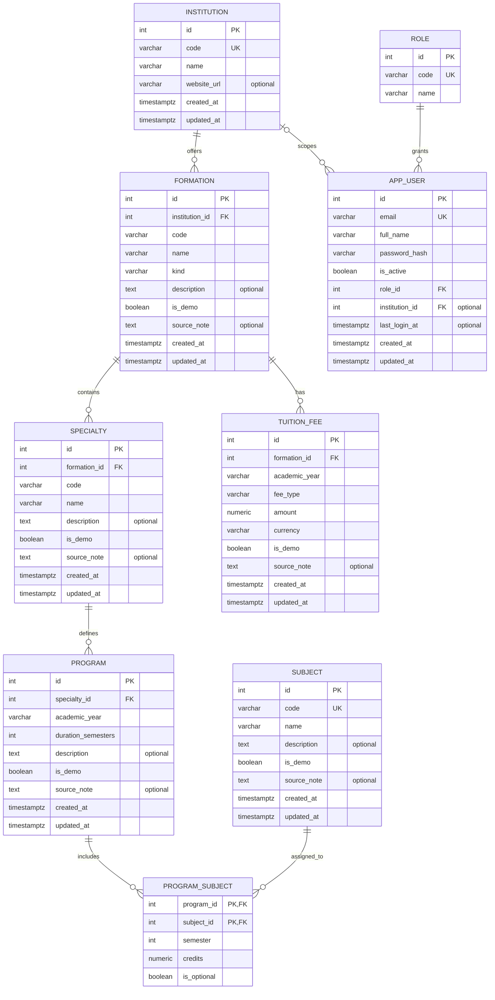

# SmartCampus database (SA-17 baseline)

This document describes the nine-table SA-17 catalog and staff-account
baseline. It is not a complete diagram of the current database: the merged
SA-12, SA-13, and SA-14 model additions are summarized below and are defined in
`backend/app/models/` with their Alembic revisions.

The baseline is represented by `backend/app/models/catalog.py` and
`backend/app/models/identity.py`. The existing initial revisions are preserved.
The SA-17 revision `a17c3d8e4b61` follows the merged SA-12/13/14 migration chain
and applies NOT NULL rules to catalog values protected by range checks. It
refuses to proceed if existing rows contain NULL or blank values; review and
resolve those rows before retrying. The separate visitor-session tables remain
outside the nine-table SA-17 baseline.

## Relationships



## Tables

### `institution`

Purpose: IIT/ISB institution reference data.

| Keys and constraints | Indexes | Delete behavior |
|---|---|---|
| PK `id`; unique `code`; `website_url` optional | Unique index on `code` | No outgoing FKs |

### `formation`

Purpose: a study formation offered by an institution.

| Keys and constraints | Indexes | Delete behavior |
|---|---|---|
| PK `id`; FK `institution_id`; unique (`institution_id`, `code`); `kind` is non-empty VARCHAR | The unique index begins with `institution_id`, covering its FK lookup | Institution deletion is RESTRICTed |

### `specialty`

Purpose: a specialty within a formation.

| Keys and constraints | Indexes | Delete behavior |
|---|---|---|
| PK `id`; FK `formation_id`; unique (`formation_id`, `code`) | The unique index begins with `formation_id`, covering its FK lookup | Formation deletion is RESTRICTed |

### `program`

Purpose: a pedagogical program for one specialty and academic year.

| Keys and constraints | Indexes | Delete behavior |
|---|---|---|
| PK `id`; FK `specialty_id`; unique (`specialty_id`, `academic_year`); `duration_semesters > 0` and NOT NULL | The unique index begins with `specialty_id`, covering its FK lookup | Specialty deletion is RESTRICTed |

### `subject`

Purpose: subject reference data.

| Keys and constraints | Indexes | Delete behavior |
|---|---|---|
| PK `id`; unique `code` | Unique index on `code` | No outgoing FKs |

### `program_subject`

Purpose: subjects assigned to a program, with semester and credits.

| Keys and constraints | Indexes | Delete behavior |
|---|---|---|
| Composite PK (`program_id`, `subject_id`); `semester > 0` and NOT NULL; `credits >= 0` and NOT NULL; `is_optional` defaults false | PK covers `program_id`; `ix_program_subject_subject_id` covers `subject_id` | Both parent FKs use CASCADE because this is an association row owned by the program/subject pair |

### `tuition_fee`

Purpose: a formation's fee for an academic year and fee type.

| Keys and constraints | Indexes | Delete behavior |
|---|---|---|
| PK `id`; FK `formation_id`; unique (`formation_id`, `academic_year`, `fee_type`); `fee_type` is non-empty VARCHAR; `amount` is NUMERIC(10,2), `amount >= 0` and NOT NULL; currency defaults to TND | The unique index begins with `formation_id`, covering its FK lookup | Formation deletion is RESTRICTed |

### `role`

Purpose: staff-role reference data. Account permissions and role assignments are managed separately from this reference table.

| Keys and constraints | Indexes | Delete behavior |
|---|---|---|
| PK `id`; unique `code` | Unique index on `code` | Referenced roles cannot be deleted while an account uses them (RESTRICT) |

### `app_user`

Purpose: staff accounts. An optional institution FK supports later institution-scoped access for IIT/ISB officers.

| Keys and constraints | Indexes | Delete behavior |
|---|---|---|
| PK `id`; unique `email`; required FK `role_id`; optional FK `institution_id` | Unique index on `email`; `ix_app_user_role_id`; `ix_app_user_institution_id` | Role and institution deletion are RESTRICTed |

## Additional models from SA-12, SA-13, and SA-14

These tables are part of the current SQLAlchemy metadata and migration chain,
but are intentionally outside the nine-table SA-17 diagram above.

| Ticket | Tables | Purpose |
|---|---|---|
| SA-12 | `qualification`, `admission_condition`, `admission_condition_qualification`, `formation_prerequisite`, `subject_prerequisite` | Admission routes, accepted diplomas, and formation/subject prerequisites. |
| SA-13 | `candidate_profile`, `staff_permission`, `conversation`, `conversation_message`, `preregistration`, `equivalence_request`, `appointment_slot`, `appointment`, `interview`, `request_status_history` | Candidate profiles, responsible permissions, conversations, applications, appointments, interviews, and status history. |
| SA-14 | `document`, `document_version`, `document_event`, `document_sync_job` | Imported documents, immutable versions, change history, and synchronization jobs. |

The exact columns, constraints, and relationships for these domains are in
[`catalog.py`](../backend/app/models/catalog.py),
[`applications.py`](../backend/app/models/applications.py),
[`documents.py`](../backend/app/models/documents.py), and their corresponding
files under `backend/migrations/versions/`.

## Design notes

- All foreign keys declare `ON DELETE`: RESTRICT for ownership/reference links and CASCADE only for the `program_subject` association row.
- Primary and foreign keys use integer identifiers; `program_subject` uses the natural composite key specified in the baseline.
- Monetary values use NUMERIC, not floating point. Timestamps use timezone-aware PostgreSQL `timestamptz` columns.
- `kind` and `fee_type` remain VARCHAR rather than PostgreSQL ENUMs, with CHECK constraints rejecting empty/whitespace-only strings. This keeps category changes easy to deploy. The team has not supplied a complete allowed-value list, so no finite CHECK list is invented; add one when the vocabulary is confirmed.
- Existing `is_demo` and `source_note` provenance columns remain on catalog tables. This schema ticket inserts no rows.
- The schema tests migrate a fresh isolated PostgreSQL schema and roll back the surrounding transaction. They do not downgrade the shared `public` schema or remove its data.

## Teammate commands

Run from the repository root in PowerShell:

```powershell
Set-Location .\backend
python -m alembic current
python -m alembic upgrade head
python -m pytest tests\db -v
```

The application database credentials are read from the root `.env`; do not put
passwords in commands or documentation. `.env` is ignored by Git.

To reset a **disposable local development database** from the repository root:

```powershell
docker compose down -v
docker compose up -d db
docker compose --profile apps up --build -d
docker compose exec backend alembic upgrade head
```

`docker compose down -v` deletes the PostgreSQL volume and all rows in it. Do
not run it against a shared or production database.
